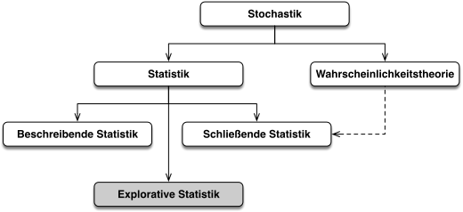
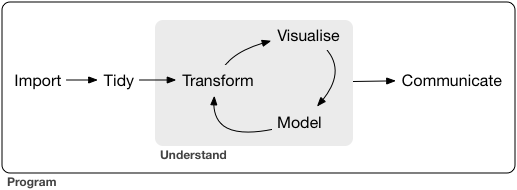
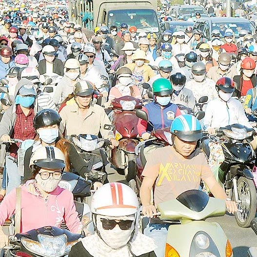
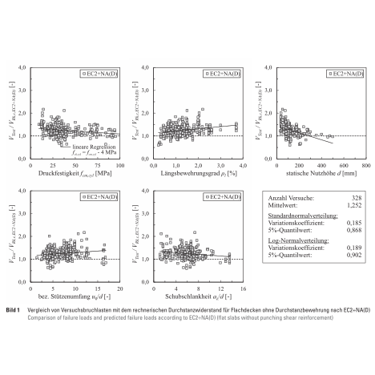
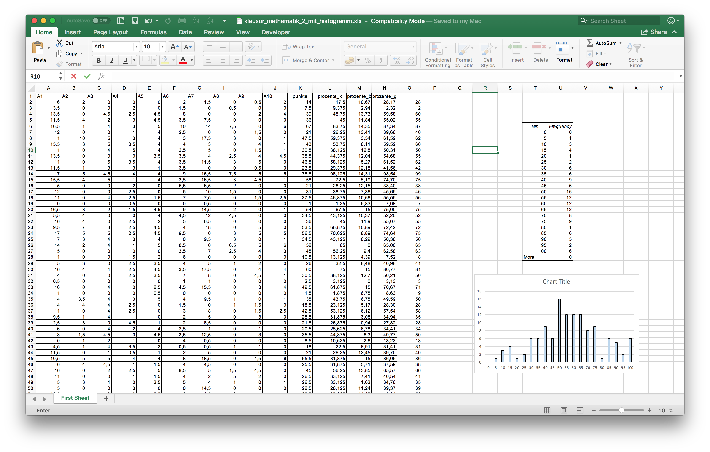
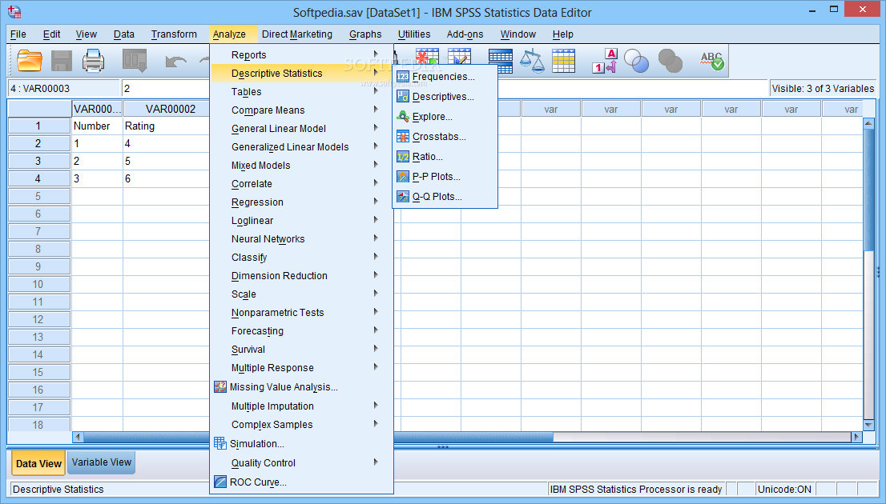
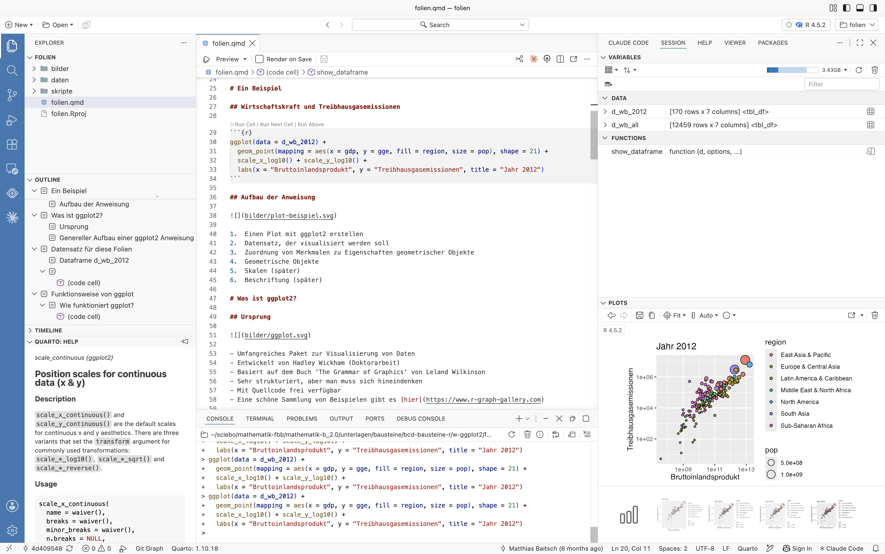

```{r}
#| cache: false
#| include: false
library(gt)
library(sf)
library(glue)
library(rdwd)
library(giscoR)
library(ggridges)
library(patchwork)
library(tidyverse)
library(reticulate)

py_require(python_version = ">=3.11")
py_require(c("matplotlib", "pandas"))
Sys.setlocale("LC_ALL", "de_DE.UTF-8")
```

## 

::: {style="font-size: 1.75em"}
Herzlich willkommen, Welcome, Hoş geldiniz, أهلاً وسهلاً, Bi xêr hatin, Добро пожаловать, Witamy serdecznie, Benvenuti, Καλώς ήρθατε, Bienvenidos, Bienvenue, خوش آمدید, ښه راغلاست, Dobro došli, Bine ați venit, Chào mừng, 欢迎, स्वागत है, እንቋዕ ብደሓን መፁ
:::

## Agenda heute

- Teil 1: Über das Modul Mathematik B
    - Statistik und Datenanalyse
    - Praktische Anwendung auf dem Computer
    - Aufbau der Vorlesung und Prüfungsleistung

- Teil 2: Installation der Software und erste Schritte

# Statistik und Datenanalyse...

## Temperaturdaten Essen-Bredeney

```{r}
d_temperatur_essen <- selectDWD(
    "Essen-Bredeney",
    res = "daily",
    var = "kl",
    per = "hr"
) |>
    dataDWD() |>
    bind_rows() |>
    select(datum = MESS_DATUM, tmin = TNK, tmittel = TMK, tmax = TXK) |>
    distinct(datum, .keep_all = TRUE) |>
    mutate(jahr = year(datum)) |>
    mutate(jahr_komplett = (n() >= 365), .by = jahr)

d <- d_temperatur_essen |>
    filter(jahr_komplett) |>
    summarise(tmittel = mean(tmittel), .by = jahr)

jrefstart <- 1961
jrefend <- 1990

tref <- d |>
    filter(jahr >= jrefstart, jahr <= jrefend) |>
    summarise(tmittel = mean(tmittel)) |>
    pull(tmittel)

d_abweichung_essen <- d |>
    mutate(tabweichung = tmittel - tref)

b <- d_abweichung_essen |>
    summarise(tmittel = max(abs(tabweichung))) |>
    pull(tmittel)

gg_essen_farbskala <- scale_fill_gradient2(
    low = "#08306b",
    mid = "#f7f7f7",
    high = "#67000d",
    limits = c(-b, b),
    midpoint = 0
)

gg_essen_beschriftung <- labs(
    x = NULL,
    y = NULL,
    title = "Änderung der Temperatur in Essen in °C",
    subtitle = glue("Bezogen auf die Jahre {jrefstart} bis {jrefend}")
)
```

::: {.columns}
::: {.column}
```{r}
d_temperatur_essen |>
    select(datum, tmin, tmittel, tmax) |>
    gt() |>
    opt_interactive(use_pagination = TRUE)
```
:::
::: {.column}
```{r}
#| fig-asp: 0.95
#| fig-width: 4
#| out-width: 100%
ggplot(data = d_temperatur_essen) +
    geom_line(mapping = aes(x = datum, y = tmittel)) +
    labs(title = "Mittlere Tagestemperatur in °C", x = NULL, y = NULL)
```
:::
:::

- Datenquelle: Deutscher Wetterdienst
- Station Essen Bredeney hat im Ruhrgebiet die meisten Datenpunkte

```{r}
#| include: false
#| fig-asp: 0.61

# Streifen mit Abweichung

p <- ggplot(data = d_abweichung_essen) +
    geom_tile(
        mapping = aes(x = jahr, y = 1, fill = tabweichung),
        show.legend = FALSE
    ) +
    scale_x_continuous(breaks = c(1940, 2020), expand = c(0, 0)) +
    scale_y_continuous(expand = expansion(0)) +
    gg_essen_farbskala +
    theme_void()

ggsave("bilder/hg-temperatur.png", p, width = 16, height = 9, dpi = 150)
```

## {background-image="bilder/hg-temperatur.png" background-size="cover"}

##

```{r}
#| fig-asp: 0.61

# Streifen mit Abweichung und Beschriftung

p +
    gg_essen_beschriftung +
    theme(axis.text.x = element_text())
```

##

```{r}
#| fig-asp: 0.61

# Abweichungen mit Trend und Konfidenzintervall

ggplot(data = d_abweichung_essen, mapping = aes(x = jahr, y = tabweichung)) +
    geom_hline(yintercept = 0, alpha = 0.1) +
    geom_smooth(
        method = "lm",
        color = "darkslateblue",
        fill = "hotpink",
        linewidth = 0.25,
        alpha = 0.15
    ) +
    geom_line(alpha = 0.2) +
    geom_segment(x = jrefstart, xend = jrefend, y = 0) +
    geom_point(
        mapping = aes(fill = tabweichung),
        shape = 21,
        size = 2,
        show.legend = FALSE
    ) +
    gg_essen_farbskala +
    gg_essen_beschriftung +
    annotate(
        "text",
        (jrefstart + jrefend) / 2,
        y = 1.5,
        label = "Bezugszeitraum",
        size = 3
    ) +
    scale_x_continuous(breaks = c(1940, 2020)) +
    scale_y_continuous(breaks = c(-1.5, 0, 1.5)) +
    theme(panel.grid = element_blank())
```

##

```{r}
#| include: false

# Mann-Kendall-Test

library(trend)
mk <- d_abweichung_essen |>
    pull(tabweichung) |>
    mk.test()
tau <- mk$estimates["tau"]
anteil_waermer <- (1 + tau) / 2

format_p_sci <- function(p) {
    e <- floor(log10(p))
    m <- p / 10^e
    sprintf("%.*f \\cdot 10^{%d}", 2, m, e)
}
```

::: {style="text-align: center; margin-top: 2em"}
Mann-Kendall-Test auf Trend

::: {style="font-size: 3em; color: darkslateblue"}
$p = `r format_p_sci(mk$p.value)`$
:::

[]{.down80}

Vergleicht man je zwei beliebige Jahre, ist in [`r round(100 * anteil_waermer)`&nbsp;%]{style="font-size: 1.5em; color: darkslateblue"} der Fälle das spätere Jahr wärmer

[]{.down120}

Statistisch hoch signifikant: Ohne Trend wäre ein so deutlicher Anstieg extrem unwahrscheinlich
:::

##

```{r}
#| fig-asp: 0.61

# Monatsmittelwerte für alle Jahre

# Hilfsfunktionen
kuerzel <- function(imin, imax) {
    case_when(
        imin & imax ~ "minmax",
        imin ~ "min",
        imax ~ "max",
        .default = "normal"
    )
}
ist <- function(x, f) f(x) == x
klassifiziere <- function(x) kuerzel(ist(x, min), ist(x, max))

# Grundlage
d1 <- d_temperatur_essen |>
    filter(jahr_komplett) |>
    mutate(monat = month(datum, label = TRUE))

# Jahresmittel
dj <- d1 |>
    summarise(tmittel = mean(tmittel), .by = jahr) |>
    mutate(jtyp = klassifiziere(tmittel))

# Monatsmittel
dm <- d1 |>
    summarise(tmittel = mean(tmittel), .by = c(jahr, monat)) |>
    mutate(mtyp = klassifiziere(tmittel), .by = monat)

# Klassifizierte Jahre mit jtyp='jahr ist min/max', jmtyp='jahr hat monat mit min/max'
djk <- dj |>
    left_join(
        dm |>
            filter(mtyp != "normal") |>
            select(jahr, mtyp) |>
            distinct(jahr, mtyp),
        by = "jahr"
    ) |>
    rename(jtmittel = tmittel, jmtyp = mtyp) |>
    replace_na(list(jmtyp = "normal"))

# Monatswerte mit Jahresklassifikation
dmk <- dm |> left_join(djk, by = "jahr")

# Min/Max Monate
d4 <- dm |>
    filter(mtyp != "normal") |>
    mutate(
        o = if_else(mtyp == "max", 1, -1)
    )

# Wärmstes und kältestes Jahr
jmax <- dj |> slice_max(tmittel)
jmin <- dj |> slice_min(tmittel)

# Plot
ggplot(mapping = aes(x = monat, y = tmittel, group = jahr)) +
    geom_line(
        data = dmk,
        mapping = aes(color = jmtyp, alpha = jtyp),
        linewidth = 0.5,
        show.legend = FALSE
    ) +
    geom_point(
        data = d4,
        mapping = aes(fill = mtyp),
        shape = 21,
        show.legend = FALSE
    ) +
    geom_text(data = d4, mapping = aes(label = jahr, nudge_y = o), size = 2.5) +
    scale_y_continuous(breaks = c(0, 20)) +
    scale_fill_manual(values = c(min = "steelblue", max = "orangered")) +
    scale_color_manual(values = c(min = "blue", normal = "gray", max = "red")) +
    scale_alpha_manual(values = c(min = 0.75, normal = 0.2, max = 0.75)) +
    labs(
        x = NULL,
        y = NULL,
        title = "Monatliche Mittelwerte der Temperatur in Essen-Bredeney in C° ",
        subtitle = glue::glue(
            "Wärmstes Jahr: {jmax$jahr} ({round(jmax$tmittel, 1)}\u202F°C)               Kältestes Jahr: {jmin$jahr} ({round(jmin$tmittel, 1)}\u202F°C)"
        )
    )
```

##  {background-color="black"}

```{r}
#| fig-asp: 1.4
#| fig-width: 6
#| fig-align: center

# Ridges wie Joy Division, Unknown Pleasures

d <- d_temperatur_essen |>
    filter(jahr_komplett)

p <- ggplot(data = d) +
    geom_density_ridges(
        mapping = aes(x = tmittel, y = factor(jahr)),
        scale = 8,
        color = "white",
        linewidth = 0.75,
        fill = "black",
        bandwidth = 0.8,
        from = -24,
        to = 44
    ) +
    scale_x_continuous(expand = c(0.02, 0), breaks = c(0, 20), labels = \(x) {
        paste0(x, "xxx°C")
    }) +
    scale_y_discrete(
        breaks = c(min(d$jahr), max(d$jahr))
    ) +
    theme_void() +
    theme(
        plot.background = element_rect(fill = "black", colour = NA)
    )
p
```

##  {background-color="black"}

```{r}
#| fig-asp: 1.4
#| fig-width: 6
#| fig-align: center

p +
    labs(title = "Temperatur in Essen", subtitle = "Verteilung über die Jahre") +
    theme(
        plot.title = element_text(color = "white"),
        plot.subtitle = element_text(color = "white"),
        axis.text.x = element_text(color = "white"),
        axis.ticks.x = element_line(color = "white"),
        axis.ticks.length.x = unit(0.2, "cm"),
        axis.text.y = element_text(color = "white")
    )
```

```{r}
#| echo: false
#| output: asis
#| fig-asp: 0.65
#| fig-dpi: 150
#| fig-align: center
#| fig-format: png
#| out-width: 90%

# Plot Extremtage deutschlandweit

# Temperaturklassen
temperaturen <- c(30, 35, 40)
klassen <- factor(c("30° ≤ T < 35°", "35° ≤ T < 40°", "T ≥ 40°"))
farben <- c("#fee08b", "#fc8d59", "#d73027")

# Zeitraum
sjahr <- 1950
jahre <- c(1983, 2000:2026)

# Daten laden, siehe skripte/extremtage.R
load("daten/d_extremtage_de.RData")

# Geobezug
data(metaIndex, package = "rdwd")
d_stationen <- metaIndex |>
    select(station = Stations_id, long = geoLaenge, lat = geoBreite) |>
    distinct(station, .keep_all = TRUE)
als_sf <- function(d) {
    d |>
        left_join(d_stationen, by = "station") |>
        st_as_sf(coords = c("long", "lat"), crs = "+proj=longlat")
}

# Deutschlandkarte
d_de <- gisco_get_nuts(country = "Germany", nuts_level = 0, resolution = 10)
d_bl <- gisco_get_nuts(country = "Germany", nuts_level = 1, resolution = 10)

# Klassifizierte Extremtage
d_kat <- d_extremtage_de |>
    filter(year(datum) >= sjahr, tmax >= temperaturen[1]) |>
    select(datum, station, tmax) |>
    mutate(
        jahr = year(datum),
        klasse = klassen[findInterval(tmax, temperaturen)]
    )

# Maximale Anzahl Hitzetage pro Jahr und Station
nmax <- d_kat |>
    count(jahr, station) |>
    slice_max(n) |>
    pull(n)

# Anzahl Tage pro Jahr und Kategorie
d_nt <- d_kat |>
    slice_max(tmax, by = c(datum)) |>
    count(jahr, klasse) |>
    complete(jahr, klasse, fill = list(n = 0))

# Anzahl Stationen pro Jahr und Kategorie
d_ns <- d_kat |>
    slice_max(tmax, by = c(jahr, station)) |>
    count(jahr, klasse) |>
    complete(jahr, klasse, fill = list(n = 0))

# Text für Legende
d_t <- left_join(
    rename(d_nt, nt = n),
    rename(d_ns, ns = n),
    by = c("jahr", "klasse")
) |>
    mutate(text = paste0(klasse, "\n", ns, " Stationen, ", nt, " Tage")) |>
    mutate(zeile = row_number(), .by = jahr)

# Barplot für ein Jahr
gg_jahr <- function(d, y, t) {
    d |>
        uncount(n) |>
        ggplot() +
        geom_bar(mapping = aes(x = jahr, fill = klasse), show.legend = FALSE) +
        geom_vline(xintercept = y, linewidth = 0.25) +
        labs(title = t)
}

# Der ganze Plot
gg_hitzetage <- function(y) {
    # Anzahl Tage pro Station und Kategorie für ein Jahr
    d_nj <- d_kat |>
        filter(jahr == y) |>
        count(jahr, station, klasse) |>
        arrange(station, desc(klasse)) |>
        mutate(n = cumsum(n), .by = station) |>
        arrange(klasse, station) |>
        als_sf()

    p_nj <- ggplot() +
        geom_sf(data = d_de, linewidth = 0.5) +
        geom_sf(data = d_bl, fill = "#676155") +
        geom_sf(
            data = d_stationen |>
                st_as_sf(coords = c("long", "lat"), crs = "+proj=longlat"),
            color = "#A7B3CD",
            size = 0.025
        ) +
        geom_sf(
            data = d_nj,
            mapping = aes(size = n, color = klasse)
        ) +
        scale_size(name = "Hitzetage", range = c(0, 7.5), limits = c(1, nmax)) +
        scale_color_manual(
            values = farben,
            drop = FALSE,
            guide = "none"
        )

    p_t <- d_t |>
        filter(jahr == y) |>
        ggplot() +
        geom_tile(
            mapping = aes(x = 0, y = zeile, fill = klasse),
            width = 0.5,
            height = 0.9,
            show.legend = FALSE
        ) +
        geom_text(
            mapping = aes(x = 0.35, y = zeile, label = text),
            hjust = 0,
            size = 4
        ) +
        geom_vline(xintercept = 3, linewidth = 0) +
        labs(title = paste("Hitzetage im Jahr", y))

    ((p_t /
        plot_spacer() /
        gg_jahr(d_ns, y, "Anzahl Stationen") /
        plot_spacer() /
        gg_jahr(d_nt, y, "Anzahl Tage") +
        plot_layout(heights = c(1, 0.1, 1, 0.1, 1.25))) |
        plot_spacer() |
        p_nj) +
        plot_layout(widths = c(1, 0.1, 2)) &
        scale_x_continuous(expand = c(0, 0)) &
        scale_y_continuous(expand = c(0, 0.1)) &
        theme_void() &
        scale_fill_manual(values = farben)
}

in_fragment <- function(y) {
    cat("::: {.fragment .current-visible}\n\n")
    print(gg_hitzetage(y))
    cat("\n\n:::\n\n")
}

cat("## \n\n")
cat("::: {.r-stack}\n\n")
jahre |> walk(in_fragment)
cat("\n\n:::\n\n")
```

## Statistik {.smaller}

{}

- Beschreibende Statistik: Darstellen und Aufbereiten von empirischen Datensätzen als Entscheidungsgrundlage (zum Beispiel in der Politik)

- Explorative Statistik: Generieren von Annahmen und Hypothesen aus Daten, mit denen die Eigenschaften der Daten erklärt werden können

- Schließende Statistik: Ableiten von Aussagen über die Grundgesamtheit aus Daten; zentrales Hilfsmittel dabei ist die Wahrscheinlichkeitstheorie (schätzen, testen, modellieren)

## Datenanalyse

{fig-align="center"}

In der Datenanalyse wird mit statistischen Methoden gearbeitet, mit welchen aus vorliegenden numerischen Einzeldaten zusammenfassende Informationen (Kenngrößen) gewonnen und tabellarisch oder grafisch aufbereitet und dokumentiert werden. (Wikipedia)

- Daten einlesen, aufbereiten, analysieren, darstellen und kommunizieren

- Querschnittsdisziplin zwischen Statistik und Informatik

- Vereinfacht gesagt: Statistik auf dem Computer

## Im Bau- und Umweltingenieurwesen {.smaller}

::: {layout-ncol=4}

{}

{}

{}

{}

:::

a) Ermittlung und Aufbereitung von Daten als Grundlage für die Planung der Verkehrsinfrastruktur.

a) Prognose der Häufigkeit und des Ausmaßes zukünftiger Starkregenereignisse auf Basis von Aufzeichnungen. Entwicklung stochastischer Modelle für fließende Gewässer.

a) Entwicklung und Anwendung probabilistischer Sicherheitskonzepte, die streuenden Materialparametern und unsicheren Einwirkungen Rechnung tragen.

a) Ausertung von Messwerten einer Versuchsreihe zu Stahlbetondecken, offensichtlich streuen die Werte stark.

# Praktische Anwendung auf dem Computer...

## Tabellenkalkulation

{fig-align="center"}

- Geeignet für einfache Fragestellungen 
- Man muss nichts grundsätzlich Neues lernen
- Häufig unhandlich und umständlich in der Anwendung

## Exkurs Excel 1/2

{fig-align="center"}

Wolfgang Schäuble in seiner Haushaltsrede im Bundestag: „Man muss daran erinnern, dass die US-Ökonomen Rogoff und Reinhart vor kurzem in einer viel beachteten Untersuchung dargelegt haben, dass das Wirtschaftswachstum ab einem bestimmten Verschuldungsgrad der öffentlichen Haushalte durch öffentliche Verschuldung nicht mehr gesteigert, sondern gedämpft wird.“

[Quelle: Deutscher Bundestag, [Plenarprotokoll 17/122](https://dserver.bundestag.de/btp/17/17122.pdf), 6.9.2011, S. 14351]{style="font-size: 0.6em"}

## Exkurs Excel 2/2

{fig-align="center"}

- Google-Suche: The Excel error that changed history 
- <https://de.wikipedia.org/wiki/Kenneth_S._Rogoff>
- Der Standard: [Wie ein Student Top-Ökonomen aufblättert](https://derstandard.at/1385169111513/Wie-ein-Student-Top-Oekonomen-aufblaettert)

## SPSS – Statistical Package for the Social Sciences

{fig-align="center"}

- Umfangreiches Statistikpaket
- Weit verbreitet in Wirtschafts- und Sozialwissenschaften, Medizin
- Komfortabel in der Anwendung, aber eher unflexibel
- Teuer

##

[]{.up20}

::: {.panel-tabset}

## Programmiersprache Python

```{python}
#| echo: true
#| message: false
#| code-fold: true
#| code-line-numbers: true
import pandas as pd
import matplotlib.pyplot as plt

df = pd.read_csv(
    "daten/6342800.day",
    sep=";",
    comment="#",
    encoding="windows-1252",
    skipinitialspace=True,
    parse_dates=["YYYY-MM-DD"],
)

df["monat"] = df["YYYY-MM-DD"].dt.month
df_summary = df.groupby("monat")["Original"].agg(
  mittelwert="mean", min="min", max="max"
)
x = df_summary.index
y = df_summary["mittelwert"]
yerr = [y - df_summary["min"], df_summary["max"] - y]
monate = [
  "Jan", "Feb", "Mär", "Apr", "Mai", "Jun", "Jul", "Aug", "Sep", "Okt", "Nov", "Dez"
]

plt.grid()
plt.bar(x, y)
plt.errorbar(x, y, yerr=yerr, fmt="none", ecolor="black", capsize=10)
plt.title("Abfluss der Donau am Pegel Hofkirchen\nMonatliche Mittel- und Extremwerte")
plt.xlabel("Monat")
plt.ylabel("Abfluss in m³/s")
plt.xticks(ticks=x, labels=monate);
plt.show()
```

##  Programmiersprache R

```{r}
#| echo: true
#| warning: false
#| code-fold: true
#| code-line-numbers: true
library(tidyverse)

df <- read_delim("daten/6342800.day", delim = ";", comment = "#", trim_ws = TRUE) |>
    mutate(monat = month(`YYYY-MM-DD`, label = TRUE)) |>
    group_by(monat) |>
    summarise(mittelwert = mean(Original), min = min(Original), max = max(Original))

ggplot(data = df) +
    geom_col(mapping = aes(x = monat, y = mittelwert)) +
    geom_errorbar(mapping = aes(x = monat, ymin = min, ymax = max)) +
    labs(
        x = "Monat",
        y = "Abfluss in m³/s",
        title = "Abfluss der Donau am Pegel Hofkirchen",
        subtitle = "Monatliche Mittel- und Extremwerte"
    )
```

:::

[]{.up50}
→ Zu Demonstrationszwecken, Darstellung nicht ideal

## Mathematik B: Quarto, R und Positron {.smaller}

{fig-align="center"}

- Quarto: System zur Erstellung von Dokumenten mit Text und Programmcode
- R: Aufbereitung von Daten und Plotten einfacher als in Python
- Positron: Grafische Umgebung für Quarto und R
- Sehr mächtig, aber erfordert Einarbeitung
- Frei verfügbar

→ So wenig Informatik wie möglich!

# Aufbau der Vorlesung und Prüfungsleistung...

## Aufbau der Vorlesung

{fig-align="center"}

### Inverted Classroom

- Erklärvideos zu den Inhalten zu Hause anschauen
- Neue Videos werden jeweils bis Ende der Woche freigeschaltet
- Fragen diskutieren, Aufgaben lösen und „echte“ Daten analysieren in Präsenz

## Prüfungsleistung

- Hausarbeit mit mündlicher Prüfung
  - Form: Schriftliche Ausarbeitung oder Präsentation
- Themen aus den Bereichen Konstruktiver Ingenieurbau, Wasser und Verkehr
  - Ausgabe Ende des Jahres
- Eigene Themen sind möglich
- Betreuung durch mich und die Fachkolleg:innen

## Was ändert sich gegenüber den letzten Jahren?

[]{.down200}

- Positron statt RStudio
- Zusätzlich Wahrscheinlichkeitsrechnung und schließende Statistik
- Mündliche Prüfung umfasst jetzt Mathematik und R
- Wir werden explizit KI nutzen
  - Wichtig: Erst Grundprinzipien verstehen, dann KI einsetzen

# Installation der Software und erste Schritte...

## Aufgaben

- R und Positron installieren (Anleitung auf Moodle)

- Folien herunterladen und in Positron öffnen
  - Zip-Datei [01-erste-schritte.zip](../../r-folien/c/01-erste-schritte.zip) herunterladen
  - In Ordner `studium/mathematik-b/r-folien/` entpacken
  - Datei erste-schritte.code-workspace in Positron öffnen
  - Datei `erste-schritte.qmd` in Positron anschauen
  - Gemeinsam durchgehen